# ⚛️ KRONOS // FLOW STUDIO v2.0
> **Offline Study Focus & Productivity OS** — Glassmorphism + Neumorphism Fusion


**KRONOS // FLOW STUDIO v2.0** is a self-contained, offline-first study cockpit and productivity operating system. It combines a multi-mode Chrono-Study timer, a procedural Web Audio Lo-Fi synthesizer, gamified XP progression, 7-day visual analytics, 3D active recall flashcards, and a multi-tab Markdown note studio in a zero-dependency architecture.
---

<div align="center">


</div>

---
## 📸 Screenshots

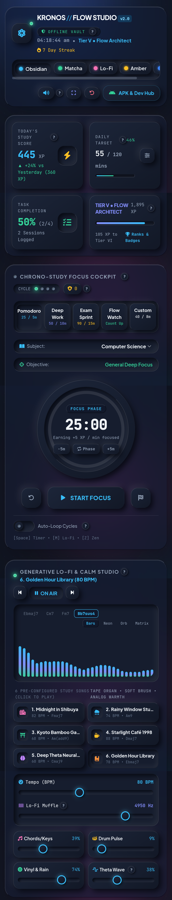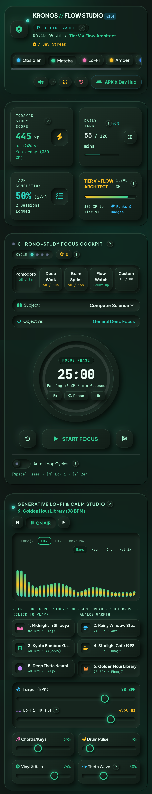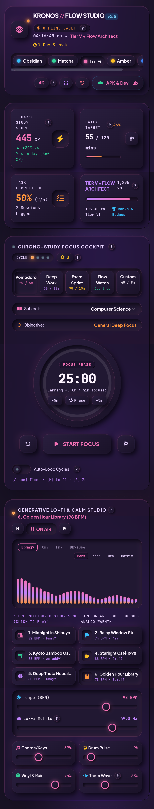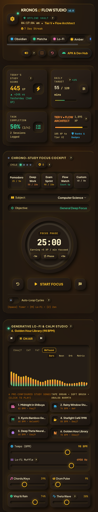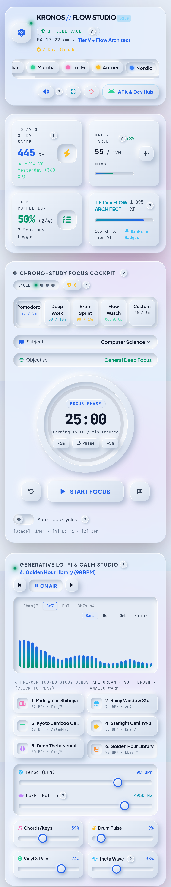 
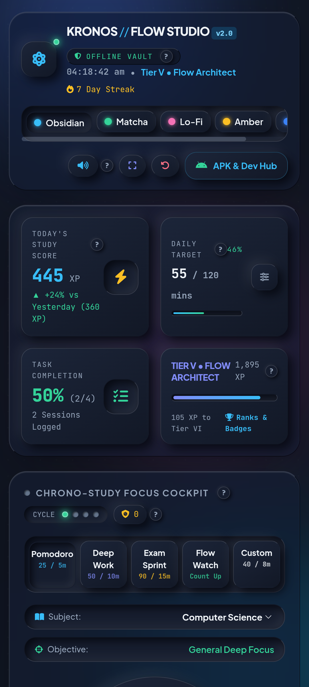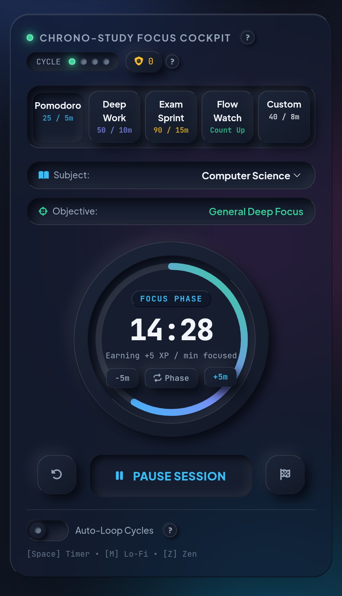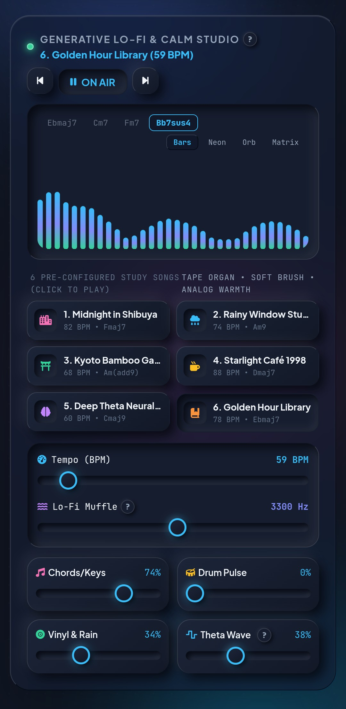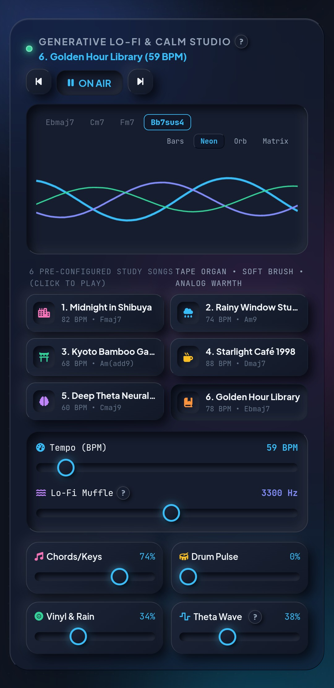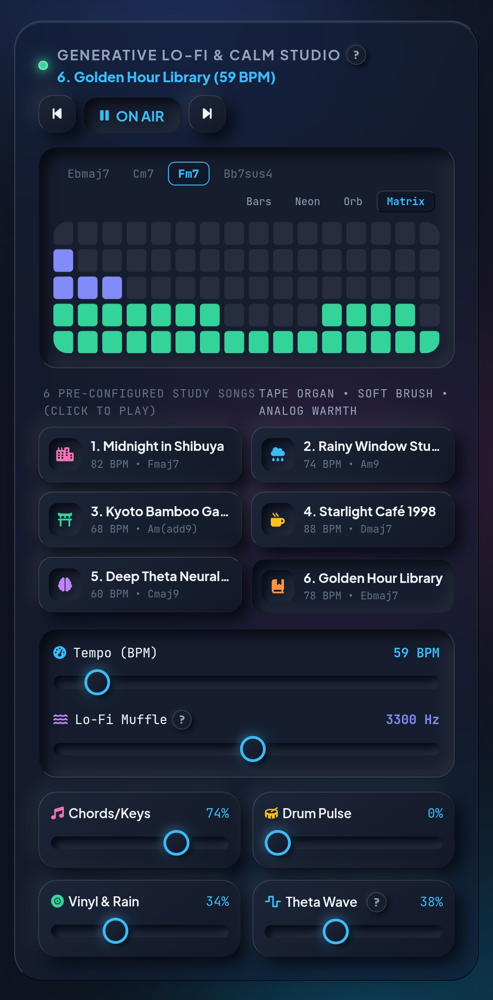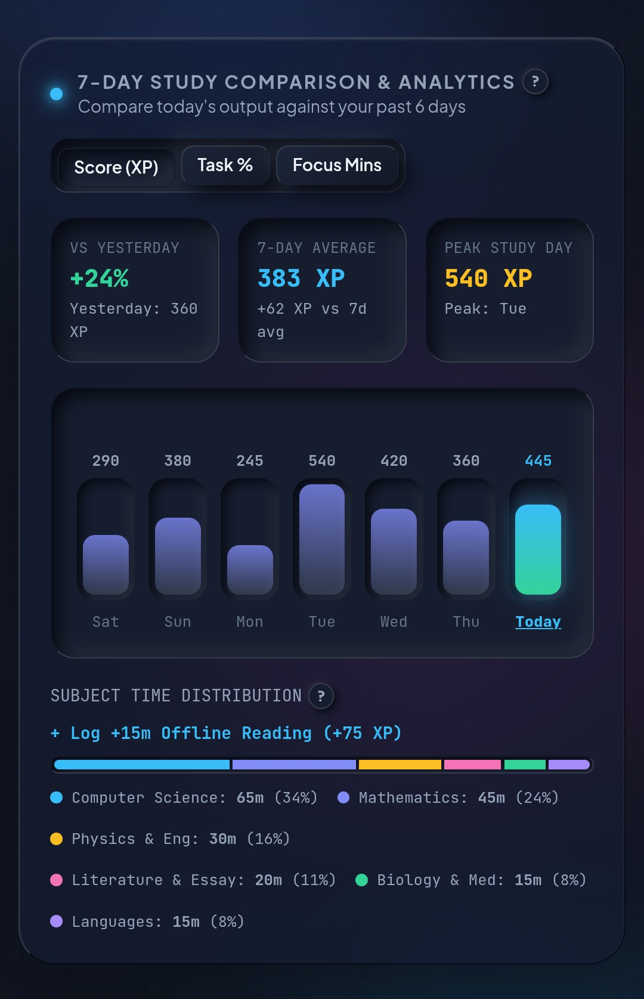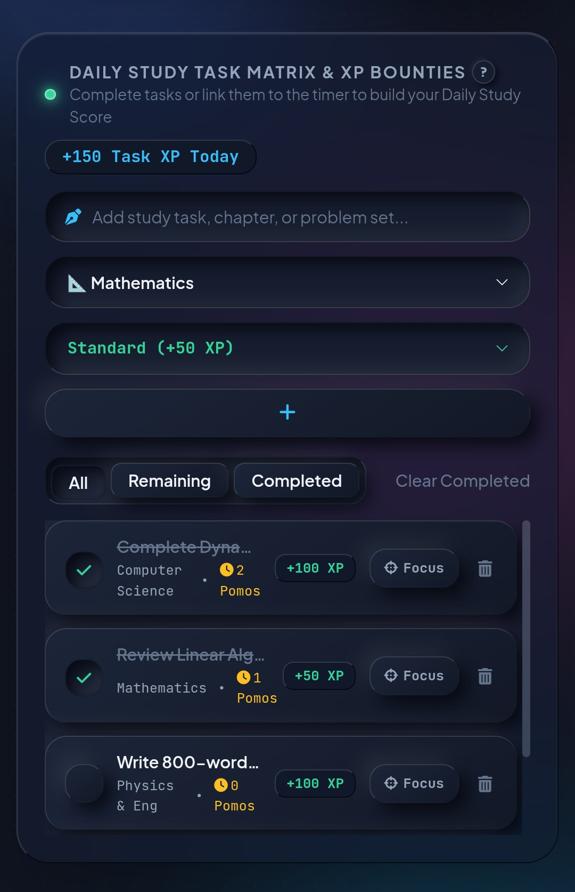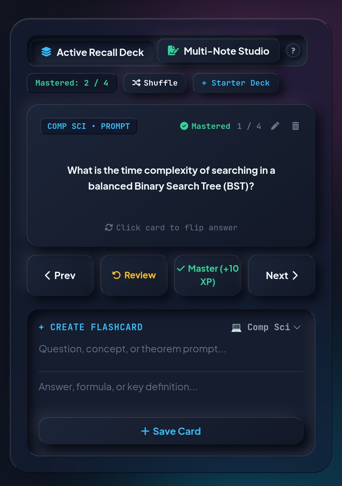

---
## ✨ Key Features
### ⏱️ 1. Chrono-Study Focus Cockpit
* **5 Focus Modes:** Pomodoro (`25/5m`), Deep Work (`50/10m`), Exam Sprint (`90/15m`), Flow Watch (`Count Up`), and Custom (`5–150m` Focus / `2–45m` Break).
* **4-Cycle Long Break Engine:** Automatically triggers a double-length Recharge Break after every 4th Pomodoro cycle.
* **Mindful Distraction Shield:** Log phone or distraction impulses mid-session to stay mindful and stay on track.
* **Task & Subject Linking:** Lock any task from your Daily Matrix directly into the timer to log Pomodoros and subject minutes automatically.
### 🎶 2. Generative Lo-Fi & Calm Studio (Web Audio Synth)
* **100% Procedural Audio:** Synthesizes Rhodes/Felt piano chords, pentatonic melodies, boom-bap percussion, vinyl crackle, rain mist, and 216Hz/222Hz (6Hz Theta) binaural waves in real time.
* **6 Pre-Configured Study Songs:**
  1. *Midnight in Shibuya* (`82 BPM • Fmaj7`)
  2. *Rainy Window Study* (`74 BPM • Am9`)
  3. *Kyoto Bamboo Garden* (`68 BPM • Am(add9)`)
  4. *Starlight Café 1998* (`88 BPM • Dmaj7`)
  5. *Deep Theta Neural Flow* (`60 BPM • Cmaj9`)
  6. *Golden Hour Library* (`78 BPM • Ebmaj7`)
* **Master Sound Controls:** Adjust Tempo (`54–112 BPM`), Lo-Fi Low-Pass Muffle (`400Hz–6000Hz`), 4 layer mix faders, and 4 visualizer modes (*Bars*, *Neon*, *Orb*, *Matrix*).
### 🏆 3. Gamified Study XP & 10-Tier Scholar Ladder
* **Scoring Formula:** `+5 XP` per focused minute, `+25 to +200 XP` per completed task (*Quick*, *Standard*, *Deep Work*, *Exam Boss*), and `+10 XP` per mastered flashcard.
* **10 Scholar Tiers:** Progress from *Tier I • Novice Initiate* (`0 XP`) to *Tier X • Grandmaster Chronomancer* (`8,500+ XP`).
* **8 Unlockable Achievements:** Earn badges including *First Focus*, *Task Initiator*, *Deep Worker*, *Recall Master*, *Goal Crusher*, *XP Centurion*, *Flow Streak*, and *Flow Architect*.
### 📈 4. 7-Day Analytics & Study Tools
* **7-Day Comparison Studio:** Compare today's performance against yesterday, your 7-day average, and your peak day across **Score (XP)**, **Task %**, and **Focus Mins**.
* **Active Recall 3D Flashcards:** Interactive 3D flip cards with inline editing, deck shuffling, and Spaced Mastery tracking.
* **Multi-Note Studio:** Multi-tab scratchpad with quick math & formatting snippets (`[ ]`, `•`, `∫`, `∑`, `√()`, `⇒`, timestamp) and `.md` export.
* **5 Curated Themes & Tactile Audio:** Switch between *Obsidian*, *Matcha*, *Lo-Fi*, *Amber*, and *Nordic* themes with synthesized mechanical keyswitch "Thock" audio.
---
## ⌨️ Keyboard Shortcuts

| Key | Action |
| :--- | :--- |
| `Space` | Start / Pause Focus Timer |
| `M` | Play / Pause Generative Lo-Fi Music |
| `Z` | Toggle Fullscreen Distraction-Free Zen Mode |
| `N` | Focus New Study Task Input |
| `Esc` | Close Active Modals |

---
## 📦 Building for Android (APK) & Desktop (Electron)
### Option A: Run Directly (Web / Offline HTML)
Open `kronos-flow-studio-offline.html` (or rename to `index.html`) in any modern browser. You can also export/import your full data anytime via **APK & Dev Hub -> Backup Vault (.json)**.
### Option B: Build Signed Android APK (Capacitor)
```bash
npm install @capacitor/core @capacitor/cli @capacitor/android
npx cap init "Kronos Flow Studio" "com.kronos.flowstudio" --web-dir .
npx cap add android && npx cap copy
# Generate V1+V2 Keystore & Sign APK:
keytool -genkey -v -keystore kronos-release.keystore -alias kronos -keyalg RSA -keysize 2048 -validity 10000 -storepass kronos123 -keypass kronos123 -dname "CN=Kronos Studio, O=FlowOS, C=US"
cd android && ./gradlew assembleRelease
apksigner sign --ks ../kronos-release.keystore --ks-pass pass:kronos123 app/build/outputs/apk/release/app-release-unsigned.apk
